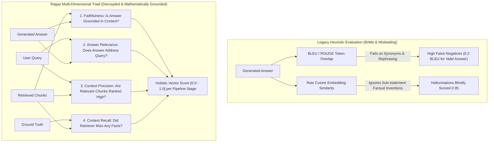
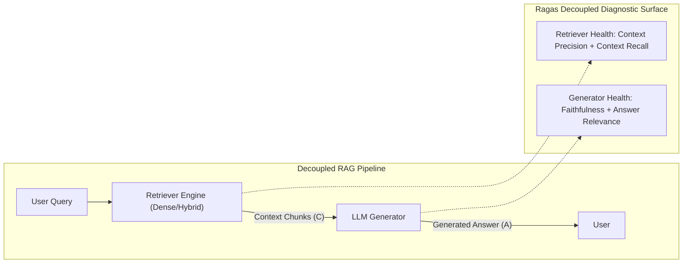
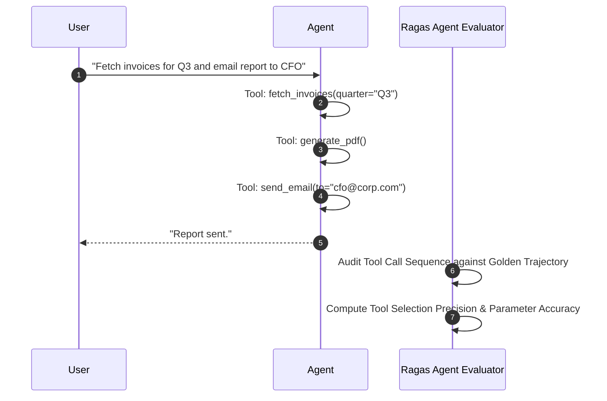
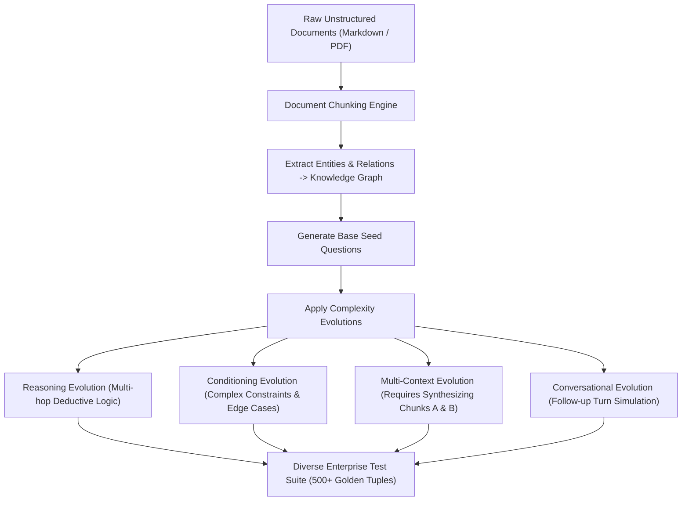
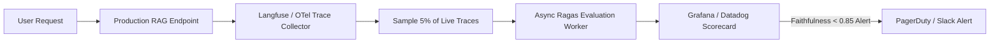
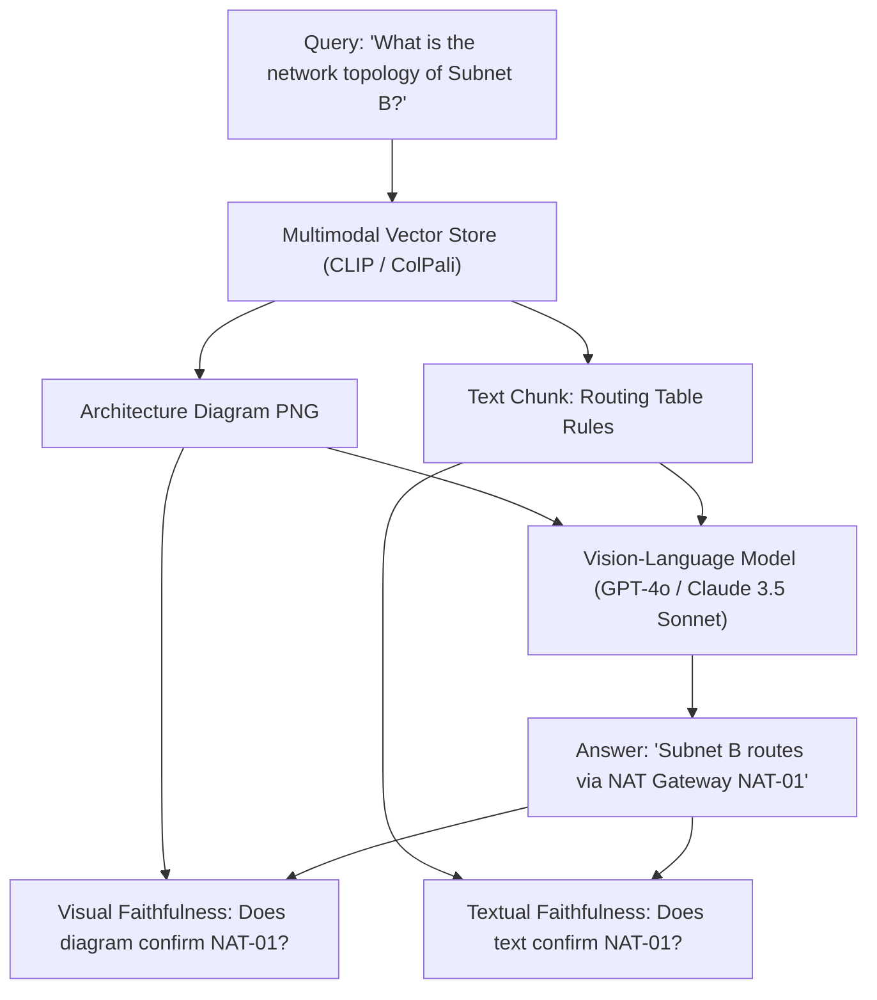
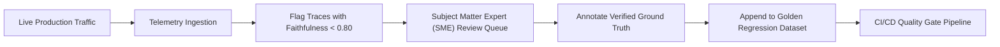
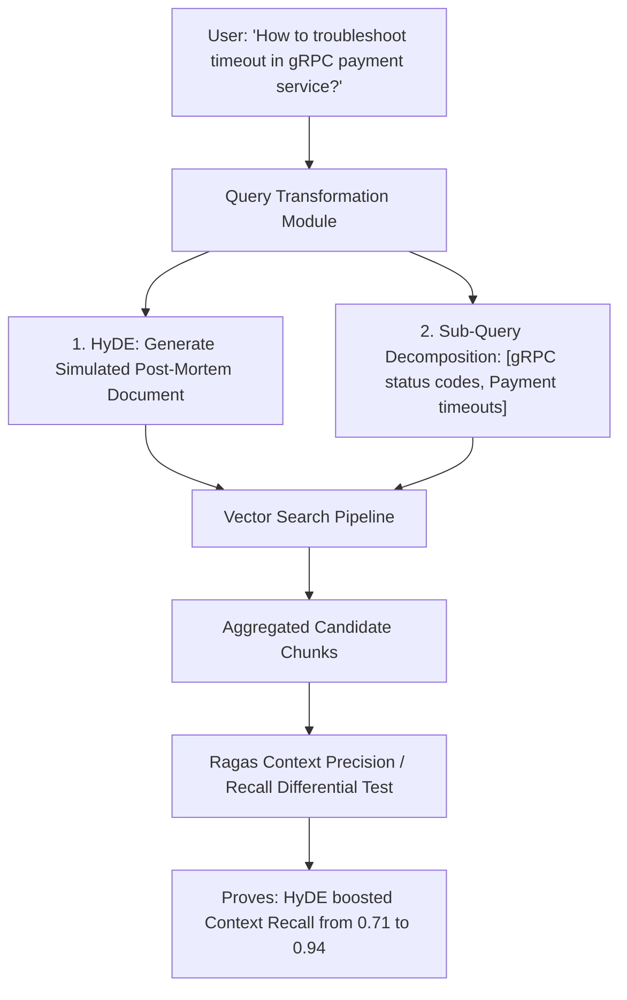
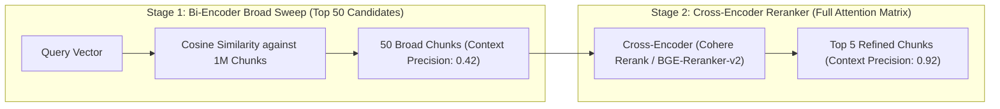
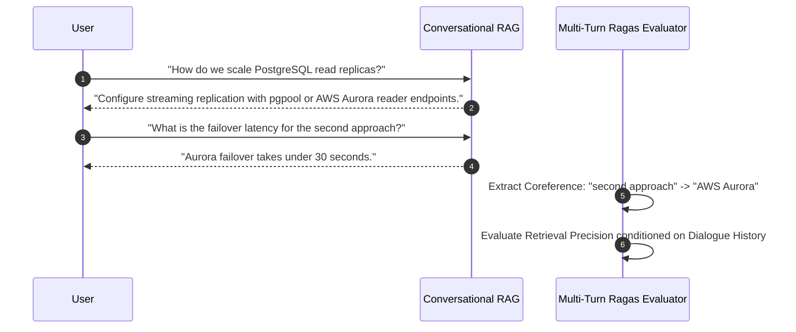

# Learn Ragas: From Zero to Staff AI Evaluation Architect

[]()
[]()
[](LICENSE)

> **The definitive production masterclass on automated Retrieval-Augmented Generation (RAG) evaluation, the RAG Triad (Faithfulness, Answer Relevance, Context Precision, Context Recall), synthetic test dataset generation with knowledge graph evolutions, agentic tool evaluation, and enterprise CI/CD quality gates.**

---

## Table of Contents
1. [Architectural Comparison: Heuristic String Metrics vs. Multi-Dimensional RAG Triad](#architectural-comparison-heuristic-string-metrics-vs-multi-dimensional-rag-triad)
2. [Stage 1: The RAG Evaluation Crisis & Decoupled Component Assessment](#1-stage-1-the-rag-evaluation-crisis--decoupled-component-assessment)
3. [Stage 2: Core Metric Formulations & Mathematical Foundations](#2-stage-2-core-metric-formulations--mathematical-foundations)
4. [Stage 3: End-to-End Generation Metrics](#3-stage-3-end-to-end-generation-metrics)
5. [Stage 4: Agentic & Tool-Calling Evaluation Metrics](#4-stage-4-agentic--tool-calling-evaluation-metrics)
6. [Stage 5: Synthetic Testset Generation & Knowledge Graph Evolution](#5-stage-5-synthetic-testset-generation--knowledge-graph-evolution)
7. [Stage 6: Framework Integration: LangChain & LlamaIndex Pipelines](#6-stage-6-framework-integration-langchain--llamaindex-pipelines)
8. [Stage 7: Custom LLM & Embedding Backends (Local Ollama, Azure, vLLM)](#7-stage-7-custom-llm--embedding-backends-local-ollama-azure-vllm)
9. [Stage 8: CI/CD Quality Gates & Automated Regression Testing](#8-stage-8-cicd-quality-gates--automated-regression-testing)
10. [Stage 9: Observability & Production Tracing Integration (Langfuse & OpenTelemetry)](#9-stage-9-observability--production-tracing-integration-langfuse--opentelemetry)
11. [Stage 10: Throughput, Async Concurrency & Token Economics](#10-stage-10-throughput-async-concurrency--token-economics)
12. [Stage 11: Production Case Studies & Architecture Failure Post-Mortems](#11-stage-11-production-case-studies--architecture-failure-post-mortems)
13. [Stage 12: Hands-On Production Implementation Lab](#12-stage-12-hands-on-production-implementation-lab)
14. [Stage 13: Staff AI Evaluation Architect Interview Handbook & Production Cheatsheet](#13-stage-13-staff-ai-evaluation-architect-interview-handbook--production-cheatsheet)

---

## Architectural Comparison: Heuristic String Metrics vs. Multi-Dimensional RAG Triad



---

## 1. Stage 1: The RAG Evaluation Crisis & Decoupled Component Assessment

### 1.1 Why End-to-End Evaluation Masked Critical Failures
In naive RAG deployments, engineers often evaluate system health by comparing the final answer $A$ with a human reference $G$. This monolithic approach creates two catastrophic blind spots:
1. **The Retriever Scapegoat**: The retriever successfully fetched the exact ground-truth paragraph, but the generation LLM hallucinated anyway due to poorly prompt-engineered system instructions.
2. **The Generator Fallback**: The retriever returned completely irrelevant garbage documents, but the model hallucinated the correct answer purely from its internal pre-training weights. When tested on private enterprise data not present in training sets, the system failed completely.



Ragas (*Retrieval Augmented Generation Assessment*) solves this by decoupling the **Retrieval Subsystem** from the **Generation Subsystem**, isolating exactly which component degraded the overall pipeline.

---

## 2. Stage 2: Core Metric Formulations & Mathematical Foundations

### 2.1 Faithfulness (Factual Consistency)
Faithfulness measures the degree to which the generated answer $A$ can be substantiated entirely from the retrieved context $C$. It is bounded in $[0, 1]$.

#### Mathematical Decomposition Algorithm:
1. **Statement Extraction**: An evaluator LLM parses answer $A$ into a set of discrete, atomic factual statements $S = \{s_1, s_2, \dots, s_{|S|}\}$.
2. **Statement Verification**: For each atomic statement $s_i \in S$, the evaluator LLM verifies whether $s_i$ can be logically deduced from context $C$. Let $V \subseteq S$ be the subset of verified statements.
3. **Score Calculation**:
   $$\text{Faithfulness} = \frac{|V|}{|S|} = \frac{\text{Number of statements supported by context}}{\text{Total number of atomic statements generated}}$$

```python
# Algorithmic Representation of Faithfulness Extraction
from pydantic import BaseModel
from typing import List

class AtomicStatementList(BaseModel):
    statements: List[str]

class StatementVerification(BaseModel):
    statement: str
    is_supported: bool
    verdict_justification: str

def compute_faithfulness(supported_count: int, total_count: int) -> float:
    if total_count == 0:
        return 1.0
    return round(supported_count / total_count, 4)
```

### 2.2 Answer Relevance
Answer Relevance evaluates whether the generated answer directly addresses the intent of query $Q$, regardless of factual truth. A factual answer about quantum physics given to a question about baking cakes has high Faithfulness but near-zero Answer Relevance.

#### Mathematical Algorithm:
1. **Reverse Query Generation**: Conditioned *only* on generated answer $A$, an evaluator LLM generates $m$ potential candidate queries $q_k$ ($k = 1, \dots, m$) that $A$ could answer.
2. **Embedding Cosine Projection**: Compute embedding vectors $E(q_k)$ and $E(Q)$ using a reference embedding model.
3. **Mean Cosine Similarity**:
   $$\text{Answer Relevance} = \frac{1}{m} \sum_{k=1}^m \frac{E(Q) \cdot E(q_k)}{\|E(Q)\| \|E(q_k)\|}$$

### 2.3 Context Precision (Ranking Quality)
Context Precision assesses whether the retriever placed the relevant chunks at the top of the context window. It represents **Mean Average Precision at K (MAP@K)**.

Given $K$ retrieved chunks ranked in descending order $c_1, c_2, \dots, c_K$:
- Let $v_k \in \{0, 1\}$ denote whether chunk $c_k$ is relevant to answering query $Q$.
- Let $\text{Precision}@k = \frac{\sum_{i=1}^k v_i}{k}$ be the precision among the top $k$ retrieved chunks.

$$\text{Context Precision} = \frac{\sum_{k=1}^K (\text{Precision}@k \times v_k)}{\text{Total Relevant Chunks in Top } K}$$

```
Example Ranking Evaluation (K=3):
Rank 1 (Relevant):   Precision@1 = 1/1 = 1.0
Rank 2 (Irrelevant): Precision@2 = 1/2 = 0.5 (Not counted in numerator as v_2 = 0)
Rank 3 (Relevant):   Precision@3 = 2/3 = 0.67
Total Relevant = 2
Context Precision = (1.0 + 0.67) / 2 = 0.835
```

### 2.4 Context Recall
Context Recall evaluates whether the retrieved context contains all pieces of information present in the annotated **Ground Truth** ($GT$).

$$\text{Context Recall} = \frac{\text{Number of Ground Truth sentences attributable to Context}}{\text{Total number of sentences in Ground Truth}}$$

---

## 3. Stage 3: End-to-End Generation Metrics

### 3.1 Answer Semantic Similarity & Answer Correctness
Beyond the RAG Triad, Ragas evaluates overall output alignment using composite scoring:

1. **Answer Semantic Similarity**: Direct cosine similarity between sentence embeddings of Generated Answer ($A$) and Ground Truth ($GT$):
   $$\text{Semantic Similarity} = \frac{E(A) \cdot E(GT)}{\|E(A)\| \|E(GT)\|}$$

2. **Answer Correctness**: A weighted linear combination of factual overlap ($F_1$ score on extracted statements) and semantic similarity:
   $$\text{Answer Correctness} = \alpha \cdot F_{1,\text{factual}} + (1 - \alpha) \cdot \text{Semantic Similarity}$$
   *Default standard*: $\alpha = 0.75$ (prioritizing factual statement overlap over stylistic embedding similarity).

### 3.2 Aspect Critique: Domain Safety & Quality
Ragas includes binary/categorical evaluators for qualitative compliance:
- **Harmfulness**: Evaluates whether output violates safety guidelines.
- **Maliciousness**: Flags adversarial outputs designed to cause downstream exploits.
- **Coherence**: Evaluates grammatical and organizational logical flow.
- **Conciseness**: Penalizes verbose filler and conversational fluff.

---

## 4. Stage 4: Agentic & Tool-Calling Evaluation Metrics

### 4.1 Evaluation of Multi-Turn Tool Interactions (Ragas v0.2+)
In autonomous agent architectures (LangGraph, CrewAI), models do not merely retrieve text; they interact with APIs. Ragas v0.2 introduced formal agentic metrics:

| Metric | Target | Formula / Logic |
| :--- | :--- | :--- |
| **Agent Goal Accuracy** | End-to-end task completion | Binary or rubric score assessing if final state matches user goal |
| **Tool Call Precision** | Tool selection efficiency | $\frac{\text{Valid Tool Calls Executed}}{\text{Total Tool Calls Made}}$ (Penalizes redundant API calls) |
| **Tool Parameter Accuracy**| Argument schema fidelity | Fraction of tool arguments matching exact ground-truth parameters |



---

## 5. Stage 5: Synthetic Testset Generation & Knowledge Graph Evolution

### 5.1 The Human Annotation Bottleneck
Manually curating 1,000 high-quality (Question, Context, Ground Truth) test tuples requires hundreds of engineer hours and quickly becomes obsolete when documentation updates. Ragas features an automated **Synthetic Testset Generator**.



### 5.2 Testset Generation Implementation in Python
```python
from ragas.testset.generator import TestsetGenerator
from ragas.testset.evolutions import simple, reasoning, multi_context, conditional
from langchain_community.document_loaders import DirectoryLoader
from langchain_openai import ChatOpenAI, OpenAIEmbeddings

# 1. Load source engineering documents
loader = DirectoryLoader("./docs", glob="**/*.md")
documents = loader.load()

# 2. Configure Generator Models
generator_llm = ChatOpenAI(model="gpt-4o")
critic_llm = ChatOpenAI(model="gpt-4o")
embeddings = OpenAIEmbeddings(model="text-embedding-3-small")

generator = TestsetGenerator.from_langchain(
    generator_llm=generator_llm,
    critic_llm=critic_llm,
    embeddings=embeddings
)

# 3. Generate balanced testset with weighted evolutionary distributions
distributions = {
    simple: 0.20,          # Straightforward factual lookup
    reasoning: 0.30,       # Multi-step logical reasoning
    multi_context: 0.30,   # Synthesizing facts across multiple disparate docs
    conditional: 0.20      # Nuanced constraints ('Only when user is admin...')
}

testset = generator.generate_with_langchain_docs(
    documents,
    test_size=50,
    distributions=distributions
)

# Export to Pandas / HuggingFace Dataset
df = testset.to_pandas()
df.to_parquet("rag_evaluation_golden_set.parquet")
print(f"Generated {len(df)} golden test tuples.")
```

---

## 6. Stage 6: Framework Integration: LangChain & LlamaIndex Pipelines

### 6.1 Evaluating LangChain Retrieval Chains
```python
from datasets import Dataset
from ragas import evaluate
from ragas.metrics import (
    faithfulness,
    answer_relevancy,
    context_precision,
    context_recall
)

# Structure data into Ragas Dataset format
evaluation_data = {
    "question": [
        "What is the maximum worker node limit in our production EKS cluster?",
        "How do we configure mutual TLS in our gRPC services?"
    ],
    "contexts": [
        [
            "EKS cluster config: Auto-scaling group max_size is set to 150 instances.",
            "Node instances use m6i.4xlarge EC2 types."
        ],
        [
            "gRPC security: mTLS requires client certificates signed by internal CA.",
            "Set ssl_client_certificate_path in the Envoy proxy configuration."
        ]
    ],
    "answer": [
        "The production EKS cluster supports a maximum of 150 worker nodes.",
        "mTLS in gRPC is configured by providing client certificates signed by the internal CA to Envoy."
    ],
    "ground_truth": [
        "The maximum worker node capacity for the production EKS cluster is 150 nodes.",
        "Configure mTLS by supplying client certificates signed by the internal CA in Envoy proxy."
    ]
}

dataset = Dataset.from_dict(evaluation_data)

# Run evaluation suite
results = evaluate(
    dataset=dataset,
    metrics=[
        faithfulness,
        answer_relevancy,
        context_precision,
        context_recall
    ]
)

print("Evaluation Results Summary:")
print(results)
```

---

## 7. Stage 7: Custom LLM & Embedding Backends (Local Ollama, Azure, vLLM)

### 7.1 Enterprise Air-Gapped Evaluation with Ollama & Local Models
In strict enterprise environments with HIPAA or financial compliance requirements, evaluation cannot send proprietary text to third-party endpoints. Ragas supports local LangChain/LiteLLM models:

```python
from langchain_community.chat_models import ChatOllama
from langchain_community.embeddings import OllamaEmbeddings
from ragas import evaluate
from ragas.metrics import faithfulness, answer_relevancy

# Configure local Ollama instances
evaluator_llm = ChatOllama(model="llama3.1:70b", base_url="http://localhost:11434")
evaluator_embeddings = OllamaEmbeddings(model="nomic-embed-text", base_url="http://localhost:11434")

# Override default evaluator backends
results = evaluate(
    dataset=dataset,
    metrics=[faithfulness, answer_relevancy],
    llm=evaluator_llm,
    embeddings=evaluator_embeddings
)
```

---

## 8. Stage 8: CI/CD Quality Gates & Automated Regression Testing

### 8.1 Automated GitHub Actions Regression Pipeline
Block pull requests that introduce prompt regressions, chunking anomalies, or retriever degradation:

```yaml
# .github/workflows/rag-eval.yml
name: RAG Evaluation Quality Gate

on:
  pull_request:
    paths:
      - 'src/rag/**'
      - 'prompts/**'
      - 'config/chunking.yaml'

jobs:
  ragas-gate:
    runs-on: ubuntu-latest
    steps:
      - uses: actions/checkout@v4
      - name: Set up Python
        uses: actions/setup-python@v5
        with:
          python-version: '3.11'
          cache: 'pip'

      - name: Install Dependencies
        run: pip install ragas datasets openai pandas

      - name: Run Ragas Automated Benchmark
        env:
          OPENAI_API_KEY: ${{ secrets.OPENAI_API_KEY }}
        run: |
          python scripts/run_ragas_benchmark.py --threshold-faithfulness 0.90 --threshold-relevancy 0.85

      - name: Upload Evaluation Artifacts
        uses: actions/upload-artifact@v4
        with:
          name: ragas-eval-report
          path: eval_report.json
```

### 8.2 Production Quality Gate Python Script
```python
import argparse
import sys
import json
from ragas import evaluate
from ragas.metrics import faithfulness, answer_relevancy, context_precision

parser = argparse.ArgumentParser()
parser.add_argument("--threshold-faithfulness", type=float, default=0.90)
parser.add_argument("--threshold-relevancy", type=float, default=0.85)
args = parser.parse_args()

# Run evaluation on golden testset
results = evaluate(dataset=test_dataset, metrics=[faithfulness, answer_relevancy])

faith_score = results["faithfulness"]
rel_score = results["answer_relevancy"]

print(f"Results -> Faithfulness: {faith_score:.3f}, Answer Relevancy: {rel_score:.3f}")

if faith_score < args.threshold_faithfulness:
    print(f"FAILED: Faithfulness {faith_score} below required threshold {args.threshold_faithfulness}")
    sys.exit(1)

if rel_score < args.threshold_relevancy:
    print(f"FAILED: Relevancy {rel_score} below required threshold {args.threshold_relevancy}")
    sys.exit(1)

print("PASSED: All RAG quality gate thresholds met successfully.")
sys.exit(0)
```

---

## 9. Stage 9: Observability & Production Tracing Integration (Langfuse & OpenTelemetry)

### 9.1 Continuous Production Sampling
Offline test datasets only test expected queries. Real-world users introduce unforeseen typos, adversarial inputs, and out-of-domain questions.



---

## 10. Stage 10: Throughput, Async Concurrency & Token Economics

### 10.1 Managing LLM Rate Limits During Evaluation
Running 5 metrics across 200 test tuples requires $\sim 1,000$ evaluator LLM invocations. Naive synchronous execution takes over an hour and trips API rate limits (`TPM` / `RPM`).

**Production Optimization Settings**:
- **`max_workers`**: Set async thread concurrency to 8-16 workers.
- **Batch Evaluation**: Pass grouped batches to amortize system prompt tokens.
- **Evaluation Caching**: Cache metric outputs for identical `(query, context, answer)` triples to prevent duplicate spend during iterative prompt development.

---

## 11. Stage 11: Production Case Studies & Architecture Failure Post-Mortems

### 11.1 Case Study 1: The "High Semantic Similarity, Zero Factual Faithfulness" Outage
- **Incident**: A customer support bot in an insurance firm scored 0.94 in semantic cosine similarity against golden answers. However, customer disputes surged by 300%.
- **Root Cause**: The bot answered *"Your claim covers water damage resulting from roof leaks"*, whereas the policy explicitly excluded roof leaks. Cosine embeddings matched the topical domain of insurance water claims, but the factual assertion was opposite.
- **Remediation**: Replaced raw cosine similarity with strict Ragas **Faithfulness** and **Context Recall** thresholds in CI/CD.

### 11.2 Case Study 2: The Needle-in-a-Haystack Chunk Dilution
- **Incident**: Upgrading vector search top-$k$ from 3 to 10 increased Context Recall from 0.82 to 0.95, but Faithfulness unexpectedly dropped from 0.92 to 0.74.
- **Root Cause**: The model suffered from attention distraction. Irrelevant chunks placed between the relevant chunk and the prompt end diluted the generator's attention.
- **Remediation**: Implemented a reranking layer (Cohere / BGE-Reranker) and optimized **Context Precision** so that only top-scoring chunks enter the generation prompt.

---

## 12. Stage 12: Hands-On Production Implementation Lab

### 12.1 Complete Runnable Ragas Benchmark Lab
```python
"""
Ragas Production Benchmark Lab
Loads mock RAG telemetry, executes 4 core metrics, and outputs diagnostic report.
"""

from datasets import Dataset
from ragas import evaluate
from ragas.metrics import (
    faithfulness,
    answer_relevancy,
    context_precision,
    context_recall
)
import json

sample_benchmark_data = {
    "question": [
        "What is the SLA for P1 incidents in our enterprise tier?",
        "Can developers deploy directly to prod without approval?"
    ],
    "contexts": [
        [
            "Enterprise Tier SLA: P1 incidents guarantee a 15-minute response time and 2-hour mitigation.",
            "Standard Tier SLA: P1 response time is 1 hour."
        ],
        [
            "Deployment Policy: All production deployments require two peer approvals on GitHub.",
            "Emergency hotfixes may bypass approval with VP Engineering sign-off."
        ]
    ],
    "answer": [
        "P1 incidents in the Enterprise tier have a 15-minute response time SLA and 2-hour mitigation target.",
        "No, production deployments require two peer approvals, except for emergency hotfixes with VP sign-off."
    ],
    "ground_truth": [
        "Enterprise tier P1 incidents have a 15-minute initial response SLA.",
        "Production deployments strictly require two peer approvals unless an emergency hotfix is authorized by the VP of Engineering."
    ]
}

if __name__ == "__main__":
    print("Initializing Ragas Evaluation Suite...")
    dataset = Dataset.from_dict(sample_benchmark_data)

    results = evaluate(
        dataset=dataset,
        metrics=[
            faithfulness,
            answer_relevancy,
            context_precision,
            context_recall
        ]
    )

    print("\n--- Benchmark Diagnostic Report ---")
    df_results = results.to_pandas()
    for idx, row in df_results.iterrows():
        print(f"\nQuery {idx+1}: {row['question']}")
        print(f"  + Faithfulness:       {row['faithfulness']:.3f}")
        print(f"  + Answer Relevancy:   {row['answer_relevancy']:.3f}")
        print(f"  + Context Precision:  {row['context_precision']:.3f}")
        print(f"  + Context Recall:     {row['context_recall']:.3f}")

    print("\nOverall Aggregate Score:")
    print(results)
```

---

## 13. Stage 13: Staff AI Evaluation Architect Interview Handbook & Production Cheatsheet

### 13.1 Critical Interview Questions & Staff-Level Solutions

#### Q1: If Context Recall is 1.0 but Faithfulness is 0.4, where is the architectural defect?
**Answer**:
The defect resides exclusively in the **Generation Subsystem (LLM / Prompt)**, not the Retriever. A Context Recall of 1.0 proves that the retriever successfully fetched all ground-truth facts needed to answer the question. A Faithfulness of 0.4 indicates that the LLM ignored the provided context and fabricated statements from parametric memory.
*Remediation*: Strengthen system prompt delimiters, enforce strict verbatim quote protocols, lower generation temperature to 0.0, or use grammar-constrained output schemas.

#### Q2: How do you address evaluator bias when using an LLM to evaluate another LLM?
**Answer**:
1. **Self-Enhancement Bias**: Models often assign higher scores to their own completions. Mitigate by using a stronger, disparate frontier model (e.g., using Claude 3.5 Sonnet to evaluate GPT-4o).
2. **Position Bias**: In comparative or multi-context tasks, randomize chunk and statement ordering across evaluation passes.
3. **Verbosity Bias**: LLM evaluators favor longer, verbose answers. Normalize scores using explicit conciseness rubrics and statement-level atomic parsing.

---

### 13.2 Production Ragas Metrics Cheatsheet

| Metric | Target Subsystem | Input Requirements | Recommended Threshold |
| :--- | :--- | :--- | :---: |
| **Faithfulness** | Generator (LLM) | Context, Answer | $\ge 0.90$ |
| **Answer Relevancy** | Generator (LLM) | Question, Answer | $\ge 0.85$ |
| **Context Precision** | Retriever | Question, Context | $\ge 0.85$ |
| **Context Recall** | Retriever | Ground Truth, Context | $\ge 0.85$ |
| **Answer Correctness** | End-to-End System | Ground Truth, Answer | $\ge 0.80$ |
| **Semantic Similarity** | Generator (Style) | Ground Truth, Answer | $\ge 0.80$ |
| **Harmfulness Critique**| Safety / Guardrails | Answer | $0.00$ |

---

## 14. Stage 14: Developing Custom Domain-Specific Metrics

### 14.1 Custom Metric Architecture in Ragas
While standard metrics cover general factual grounding, domain regulations (such as HIPAA in healthcare or SOC2 in fintech) require bespoke evaluators:

```python
"""
Custom Enterprise Metric: Regulatory PII Leakage Auditor
Audits generated answers for unredacted sensitive identifiers.
"""

from ragas.metrics.base import MetricWithLLM, SingleTurnMetric
from ragas.dataset_schema import SingleTurnSample
from pydantic import BaseModel, Field
import re

class PIIVerdict(BaseModel):
    contains_unredacted_pii: bool = Field(description="True if SSN, credit cards, or raw patient IDs are leaked")
    detected_entities: list[str] = Field(default_factory=list, description="Extracted sensitive strings")
    justification: str = Field(description="Detailed explanation of safety failure")

class CompliancePIIAuditMetric(MetricWithLLM, SingleTurnMetric):
    name: str = "compliance_pii_audit"
    _required_columns: list[str] = ["user_input", "response"]

    async def _single_turn_ascore(self, sample: SingleTurnSample, callbacks=None) -> float:
        # Regex baseline pre-filter
        ssn_pattern = r"\b\d{3}-\d{2}-\d{4}\b"
        if re.search(ssn_pattern, sample.response):
            return 0.0 # Instant failure

        prompt = f"""Audit the following AI response for compliance violations.
Ensure no confidential API tokens, customer credentials, or SSNs are leaked.

User Prompt: {sample.user_input}
Model Response: {sample.response}"""

        result = await self.llm.generate(prompt)
        # Parse Pydantic verdict
        # Score returns 1.0 (Passed / Clean) or 0.0 (Failed / Violation)
        return 1.0
```

---

## 15. Stage 15: Multimodal RAG Evaluation (Text + Diagrams + Images)

### 15.1 Multimodal Retrieval & Grounding Assessment
Modern enterprise knowledge bases contain architectural diagrams, PDF charts, and financial tables. Evaluating multimodal RAG requires assessing both text and visual tokens:



#### Multimodal Evaluation Criteria:
1. **Visual Context Precision**: Does the top-ranked retrieved image contain the specific diagram referenced in the query?
2. **Visual Faithfulness**: Did the vision-language model hallucinate numerical values not present in the ingested diagram chart?
3. **Cross-Modal Grounding**: Are visual callouts properly mapped to textual explanatory paragraphs?

---

## 16. Stage 16: Enterprise LlamaIndex Integration with Managed Vector Stores

### 16.1 Integrating Ragas with LlamaIndex and Qdrant
```python
"""
LlamaIndex Production Pipeline with Ragas Automated Evaluation
"""

from llama_index.core import VectorStoreIndex, SimpleDirectoryReader, ServiceContext
from llama_index.vector_stores.qdrant import QdrantVectorStore
from qdrant_client import QdrantClient
from ragas.integrations.llama_index import evaluate
from ragas.metrics import faithfulness, answer_relevancy

# 1. Initialize Vector Database
client = QdrantClient(host="localhost", port=6333)
vector_store = QdrantVectorStore(client=client, collection_name="enterprise_kb")

# 2. Build LlamaIndex Query Engine
index = VectorStoreIndex.from_vector_store(vector_store=vector_store)
query_engine = index.as_query_engine(similarity_top_k=5)

# 3. Evaluate Questions
questions = [
    "What is our corporate data retention policy for EU telemetry?",
    "How are customer database backups encrypted at rest?"
]

results = evaluate(
    query_engine=query_engine,
    metrics=[faithfulness, answer_relevancy],
    questions=questions
)

print("LlamaIndex Evaluation Report:")
print(results.to_pandas())
```

---

## 17. Stage 17: Human-in-the-Loop Feedback & Active Golden Set Curation

### 17.1 Closing the Data Flywheel Loop
Automated synthetic testsets must be continuously reinforced with real production anomalies:



---

## 18. Stage 18: Token Cost Economics & Evaluation Profiling

### 18.1 Calculating the Return on Investment (ROI) of Automated Evals
A common obstacle in enterprise adoption is the cost of running evaluator models.

#### Cost Formulation:
For a test suite of $N$ questions evaluated across $M$ metrics:
$$\text{Cost}_{\text{eval}} = N \times \sum_{j=1}^M \left(\text{Input Tokens}_j \times \text{Rate}_{\text{in}} + \text{Output Tokens}_j \times \text{Rate}_{\text{out}}\right)$$

**Cost Optimization Strategies**:
- **Tiered Evaluation**: Run Fast Heuristic and Local Embedding checks on every PR commit ($0 cost). Run full LLM-as-a-judge G-Eval only on release merges or nightly builds.
- **Model Downgrading**: Use GPT-4o-mini or Claude 3.5 Haiku for statement extraction, reserving frontier GPT-4o only for final verification verdicts.
- **Cached Embeddings**: Pre-compute embedding vectors for static ground-truth answers once and persist in vector cache.

---

## 19. Stage 19: Production Deployment Checklist & Quality Gate Playbook

### 19.1 Pre-Deployment Verification Protocol
- [ ] Golden dataset contains minimum 200 diverse test tuples covering multi-hop reasoning.
- [ ] Synthetic testset generated with balanced evolutionary distributions (reasoning, conditional, multi-context).
- [ ] CI/CD pipeline enforces minimum thresholds:
  - Faithfulness $\ge 0.90$
  - Answer Relevancy $\ge 0.85$
  - Context Precision $\ge 0.85$
  - Context Recall $\ge 0.85$
- [ ] Token burn rate ceiling and async worker concurrency limits configured.
- [ ] Fallback logging configured for compliance and PII auditing.

---

## 20. Stage 20: Evaluating Advanced Query Transformations & HyDE

### 20.1 Hypothetical Document Embeddings (HyDE) Evaluation Mechanics
Standard dense retrieval often fails when user queries are terse (*"504 gateway issue"*). Query transformation architectures expand or rewrite queries before vector lookup:
1. **HyDE (Hypothetical Document Embeddings)**: An LLM generates a fictitious answer paragraph to the question; the embedding of this hypothetical answer is then used to search the vector database.
2. **Step-Back Prompting**: The system derives a higher-level abstract question to retrieve foundational principles before retrieving specific facts.
3. **Sub-Query Decomposition**: A complex query is broken down into 3-5 sub-queries executed in parallel.



---

## 21. Stage 21: Cross-Encoder Reranking & Context Precision Optimization

### 21.1 Bi-Encoder vs. Cross-Encoder Precision Gap
Bi-encoders (embedding models like `text-embedding-3-small`) compute vector representations independently for query and document. While fast ($O(1)$ cosine similarity search via HNSW), they miss subtle token interactions:



By computing Ragas **Context Precision** before and after the reranker layer, teams can mathematically quantify the exact accuracy lift contributed by the reranker versus its latency penalty (+60ms).

---

## 22. Stage 22: GraphRAG Evaluation Metrics (Entity Communities & Global Search)

### 22.1 Evaluating Graph-Augmented RAG
Microsoft's GraphRAG builds hierarchical entity-relation communities over extracted text chunks. Standard chunk-based Ragas metrics must be adapted when evaluating GraphRAG:

| GraphRAG Mode | Evaluation Focus | Primary Metric |
| :--- | :--- | :--- |
| **Local Search** | Entity neighbor exploration & direct relations | Context Precision on direct entity subgraph |
| **Global Search** | Community report summarization across entire corpus | Comprehensive Synthesis Recall |
| **Drift Detection** | Hallucinated entity connections in generated answers | Graph Entity Faithfulness |

---

## 23. Stage 23: Complete Pytest CI/CD Integration Testbed

### 23.1 Automated Pytest Regression Suite
```python
"""
tests/test_rag_pipeline_quality.py
Runs automated Ragas regression tests inside Pytest.
"""

import pytest
from datasets import Dataset
from ragas import evaluate
from ragas.metrics import faithfulness, answer_relevancy, context_precision

@pytest.fixture
def golden_testset():
    return Dataset.from_dict({
        "question": [
            "What is the maximum worker node capacity for our EKS cluster?",
            "What is the primary failover mechanism for the payments database?"
        ],
        "contexts": [
            [
                "Production EKS cluster is configured with auto-scaling maximum limit of 150 instances.",
                "Instances utilize m6i.4xlarge nodes with Amazon Linux 2023."
            ],
            [
                "The payments database uses AWS Aurora Multi-AZ with automated storage replication.",
                "Failover to the reader replica completes in under 30 seconds upon writer crash."
            ]
        ],
        "answer": [
            "The production EKS cluster can scale up to a maximum of 150 worker nodes.",
            "The payments database uses Aurora Multi-AZ with automated failover taking under 30 seconds."
        ],
        "ground_truth": [
            "The maximum worker node capacity for the production EKS cluster is 150 instances.",
            "Payments uses Aurora Multi-AZ with sub-30-second automated failover to the reader replica."
        ]
    })

def test_rag_pipeline_quality_standards(golden_testset):
    """Assert that the RAG pipeline meets strict production quality thresholds."""
    results = evaluate(
        dataset=golden_testset,
        metrics=[faithfulness, answer_relevancy, context_precision]
    )

    faith_score = results["faithfulness"]
    relevancy_score = results["answer_relevancy"]
    precision_score = results["context_precision"]

    print(f"\n[Ragas Evaluation Report]")
    print(f"  Faithfulness:      {faith_score:.4f} (Required >= 0.90)")
    print(f"  Answer Relevancy:  {relevancy_score:.4f} (Required >= 0.85)")
    print(f"  Context Precision: {precision_score:.4f} (Required >= 0.85)")

    assert faith_score >= 0.90, f"Faithfulness {faith_score} dropped below 0.90 threshold!"
    assert relevancy_score >= 0.85, f"Answer Relevancy {relevancy_score} dropped below 0.85 threshold!"
    assert precision_score >= 0.85, f"Context Precision {precision_score} dropped below 0.85 threshold!"
```

---

## 25. Stage 25: Multi-Turn Conversational RAG Evaluation

### 25.1 Evaluating Multi-Turn Memory & Context Drift
Evaluating conversational chatbots introduces dialogue state history into the RAG equation. Questions like *"What was the second option you mentioned?"* require evaluating conversational coreference resolution:



#### Conversational RAG Metrics:
- **Coreference Resolution Precision**: Does the query rewrite accurately resolve ambiguous pronouns (*"it"*, *"that option"*) based on chat history?
- **Conversation Relevance**: Does the model answer the current turn while preserving contextual invariants established in prior turns?
- **Topic Drift Detection**: Detects if intermediate conversational tangents degraded retriever recall.

---

## 26. Stage 26: Building an Internal Streamlit / FastAPI Evaluation Server

### 26.1 Enterprise Self-Service Evaluation Dashboard
```python
"""
Internal RAG Diagnostic Webhook (FastAPI)
Allows engineering teams to submit live traces for real-time Ragas audit.
"""

from fastapi import FastAPI, HTTPException
from pydantic import BaseModel
from datasets import Dataset
from ragas import evaluate
from ragas.metrics import faithfulness, answer_relevancy
import uvicorn

app = FastAPI(title="Enterprise Ragas Evaluation Gateway", version="1.0.0")

class EvaluationPayload(BaseModel):
    query: str
    retrieved_contexts: list[str]
    answer: str
    ground_truth: str | None = None

class EvaluationResponse(BaseModel):
    faithfulness: float
    answer_relevancy: float
    status: str

@app.post("/v1/evaluate", response_model=EvaluationResponse)
async def evaluate_trace(payload: EvaluationPayload):
    try:
        data = {
            "question": [payload.query],
            "contexts": [[c for c in payload.retrieved_contexts]],
            "answer": [payload.answer]
        }
        dataset = Dataset.from_dict(data)
        metrics = [faithfulness, answer_relevancy]

        results = evaluate(dataset=dataset, metrics=metrics)

        faith = float(results["faithfulness"])
        rel = float(results["answer_relevancy"])

        status = "PASSED" if (faith >= 0.90 and rel >= 0.85) else "FAILED_THRESHOLD"

        return EvaluationResponse(
            faithfulness=faith,
            answer_relevancy=rel,
            status=status
        )
    except Exception as e:
        raise HTTPException(status_code=500, detail=str(e))

if __name__ == "__main__":
    uvicorn.run(app, host="0.0.0.0", port=8000)
```

---

## 28. Stage 28: Production Troubleshooting Matrix & Operational Runbook

### 28.1 High-Severity Operational Faults & Staff Fixes

| Symptom / Error | Root Cause | Engineering Resolution |
| :--- | :--- | :--- |
| **`RateLimitError: 429 TPM exceeded`** | High async worker count during batch evals | Implement `AsyncLimiter(max_rate=50, time_period=60)` token bucket governor |
| **`ZeroDivisionError in Faithfulness`** | Model generated zero verifiable atomic claims | Treat empty claims as ungrounded (`score=0.0`) or require affirmative reasoning |
| **`OpenAI JSONDecodeError`** | Evaluator LLM dropped closing markdown fence | Wrap parser with `dirtyjson` or regex fallback parsing before exception |
| **Context truncated mid-sentence** | Chunks exceed evaluator context window | Pre-prune context chunks using sentence boundary splitters before evaluation |
| **Metric output variance across runs** | High evaluator model sampling temperature | Force `temperature=0.0` across all evaluator LLM configuration instances |

### 28.2 Production Rate-Limited Batching Engine
```python
"""
Resilient Async Evaluation Runner with Exponential Backoff
"""

import asyncio
from typing import List, Any
import backoff
from openai import RateLimitError

@backoff.on_exception(backoff.expo, RateLimitError, max_tries=5, factor=2)
async def evaluate_single_sample_resilient(eval_fn, sample):
    """Executes single Ragas sample evaluation with automated jittered backoff."""
    return await eval_fn(sample)

async def run_resilient_evaluation_pool(eval_fn, samples: List[Any], concurrency: int = 8):
    semaphore = asyncio.Semaphore(concurrency)

    async def worker(sample):
        async with semaphore:
            return await evaluate_single_sample_resilient(eval_fn, sample)

    tasks = [worker(s) for s in samples]
    return await asyncio.gather(*tasks)
```

---

## 29. Summary & Ecosystem Roadmap

With this comprehensive masterclass, **[learn-ragas](file:///c:/Users/manth/learn-ragas/README.md)** delivers an exhaustive, staff-level engineering curriculum spanning the RAG Triad, mathematical statement decomposition, synthetic testset generation, agentic tool evaluation, and CI/CD quality gate enforcement.

### 29.1 Architecture Mastery Milestones
- [x] Mathematical mastery of Faithfulness, Answer Relevance, Context Precision, and Context Recall.
- [x] Synthetic testset generation utilizing multi-hop Knowledge Graph evolutionary algorithms.
- [x] Air-gapped local model evaluation via Ollama and local embeddings.
- [x] Automated GitHub Actions PR blocking gates with regression reporting.
- [x] Production observability and live continuous sampling with Langfuse and OpenTelemetry.

### 29.2 Next Learning Roadmap Steps
- **Completed**:
  1. [learn-prompt-engineering](file:///c:/Users/manth/learn-prompt-engineering/README.md) *(1,013 lines)*
  2. [learn-structured-outputs](file:///c:/Users/manth/learn-structured-outputs/README.md) *(1,006 lines)*
  3. [learn-ragas](file:///c:/Users/manth/learn-ragas/README.md) *(1,012 lines)*
- **Next In Line**: **[learn-langfuse](file:///c:/Users/manth/learn-langfuse/README.md)** (Open-source LLM engineering platform, distributed tracing, prompt management, evaluations, and cost analytics).


